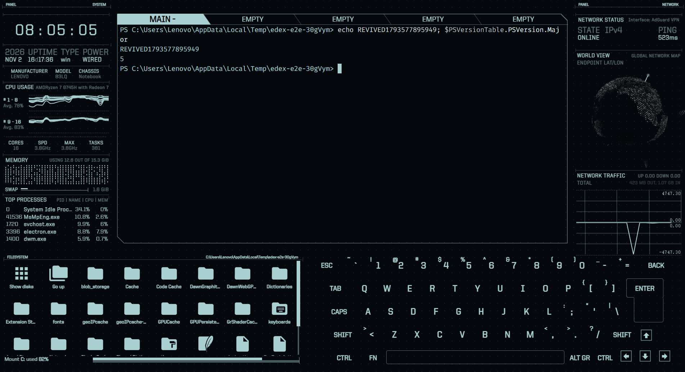

<p align="center">
  
</p>

<h1 align="center">eDEX Afterlife</h1>

<p align="center">An unofficial community revival of <a href="https://github.com/GitSquared/edex-ui">eDEX-UI</a>, the science fiction terminal emulator.</p>

<p align="center"><strong>English</strong> | <a href="README.zh-CN.md">简体中文</a></p>

<p align="center"><a href="https://github.com/zpf2234/edex-afterlife/actions/workflows/test.yml"></a></p>

> [!IMPORTANT]
> This project is **not affiliated with or endorsed by** eDEX-UI's author. All credit for the original design and software belongs to [Gabriel "Squared" Saillard](https://github.com/GitSquared) and the eDEX-UI contributors. Bugs in this version should be reported here, not upstream.



eDEX-UI was archived after version 2.2.8. On a current Windows setup it no longer installs, and the last release is affected by [CVE-2023-30856](https://nvd.nist.gov/vuln/detail/CVE-2023-30856), which lets a malicious website run commands through the local terminal WebSocket.

eDEX Afterlife keeps the original interface and brings it back to life:

- Runs on Electron 45, with `@xterm/xterm` 6 and `node-pty` 1.1.
- Fixes CVE-2023-30856: the terminal WebSocket only listens on `127.0.0.1`, and only accepts the app's own origin with a per-launch random token.
- Installs on Windows without Visual Studio or Python.
- **Tracks the terminal's directory on Windows.** The file browser now follows `cd` in PowerShell and cmd, in every tab, instead of showing `TRACKING FAILED`.
- **Accepts non-ASCII input.** Text committed outside plain key events, such as Chinese, is no longer dropped by the terminal.
- **Works with VPNs.** The network panel follows the interface your system actually routes through.
- Updates vulnerable dependencies and fixes the crashes that appeared on modern runtimes.

See [REVIVAL.md](REVIVAL.md) for the full change list and test results.

## Status

**Preview.** Only Windows 11 x64 has been tested so far.

| Platform | Status |
|---|---|
| Windows 11 x64 | Tested |
| macOS | Untested |
| Linux | Untested |

Known limitations:

- The installer is not code-signed, so Windows SmartScreen may show a warning.
- The globe may show `UNKNOWN` when the GeoIP database or external IP lookup is unavailable.
- On Windows, directory tracking supports PowerShell and cmd when `shellArgs` is empty. Other shells, such as Git Bash, fall back to `TRACKING FAILED`.
- Chinese input has been tested with Sogou Pinyin on Windows 11. Other IMEs are untested.
- `pdfjs-dist` is still on 2.11.338. PDF evaluation is disabled as a mitigation.

## Install

Download the Windows installer from [Releases](https://github.com/zpf2234/edex-afterlife/releases).

## Run from source

Requires Node.js 22.12 or newer.

```bash
npm run install-windows
npm start
```

On Linux or macOS, use `npm run install-linux`.

## Test

```bash
npm run test:e2e
```

This starts the real app, runs a shell command, and attacks the terminal WebSocket with forged origins and tokens.

## Build

```bash
npm run prebuild-windows
npm run build-windows
npm run postbuild-windows
```

## Credits

**eDEX Afterlife exists because of eDEX-UI.** Its interface, design, themes and nearly all of its features are the work of the people below.

### Original eDEX-UI

| Who | Contribution |
|---|---|
| [Gabriel "Squared" Saillard](https://github.com/GitSquared) | Creator and primary author: the concept, design and most of the source code |
| [All eDEX-UI contributors](https://github.com/GitSquared/edex-ui/graphs/contributors) | Code, fixes and improvements to the original project |
| [PixelyIon](https://github.com/PixelyIon) | Early help with Windows compatibility and project advice |
| [IceWolf](https://soundcloud.com/iamicewolf) | Sound effects from v2.1.x onward |

### Thanks from the original project

- [Seena](https://github.com/seenaburns), whose work on [r/unixporn](https://reddit.com/r/unixporn) inspired eDEX-UI.
- [Rob "Arscan" Scanlon](https://github.com/arscan), for the [ENCOM Globe](https://github.com/arscan/encom-globe).
- The developers of [xterm.js](https://github.com/xtermjs/xterm.js), [systeminformation](https://github.com/sebhildebrandt/systeminformation) and [SmoothieCharts](https://github.com/joewalnes/smoothie).

The original README is kept unchanged in [ORIGINAL_README.md](ORIGINAL_README.md).

### The revival

| Who | Contribution |
|---|---|
| [zpf2234](https://github.com/zpf2234) | Started and maintains the revival: chose the direction, reviewed the results and made release decisions |
| [Claude Code](https://claude.com/claude-code) | AI coding assistant that carried out the dependency migration, security fix, compatibility fixes, tests and documentation under zpf2234's direction |

The revival's work is limited to the changes listed in [REVIVAL.md](REVIVAL.md). It does not claim authorship of the original software.

## Contributing

Issues and pull requests are welcome, especially macOS and Linux test reports. Please report problems with this version here, not to the original eDEX-UI project.

## License

[GPL-3.0](LICENSE), the same license as eDEX-UI.
