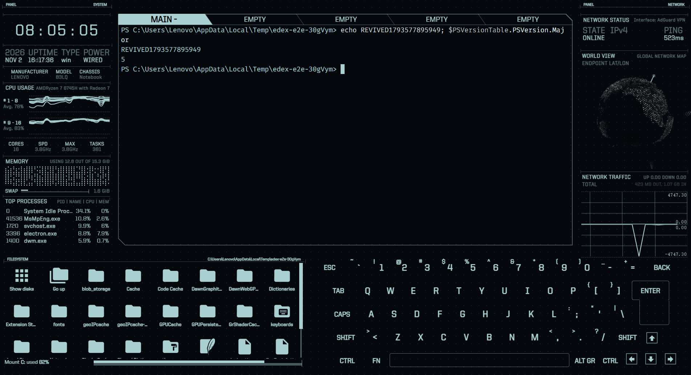

<p align="center">
  
</p>

<h1 align="center">eDEX Afterlife</h1>

<p align="center">科幻终端模拟器 <a href="https://github.com/GitSquared/edex-ui">eDEX-UI</a> 的非官方社区复活版。</p>

<p align="center"><a href="README.md">English</a> | <strong>简体中文</strong></p>

<p align="center"><a href="https://github.com/zpf2234/edex-afterlife/actions/workflows/test.yml"></a></p>

> [!IMPORTANT]
> 本项目与 eDEX-UI 的作者**没有关联，也未获其认可**。原始设计和软件的全部功劳属于 [Gabriel "Squared" Saillard](https://github.com/GitSquared) 和 eDEX-UI 的贡献者。这个版本的问题请在本仓库反馈，不要提交到原项目。



eDEX-UI 在 2.2.8 版本后已归档。在当前的 Windows 环境中，它已经无法安装，而且最后一个版本受 [CVE-2023-30856](https://nvd.nist.gov/vuln/detail/CVE-2023-30856) 影响：恶意网站可以通过本地终端 WebSocket 执行命令。

eDEX Afterlife 保留原来的界面，让它重新运行起来：

- 运行在 Electron 45 上，使用 `@xterm/xterm` 6 和 `node-pty` 1.1。
- 修复 CVE-2023-30856：终端 WebSocket 只监听 `127.0.0.1`，只接受应用自身的来源和每次启动随机生成的令牌。
- 在 Windows 上安装不再需要 Visual Studio 或 Python。
- **在 Windows 上跟踪终端目录。** 文件面板现在会在每个标签页中跟随 PowerShell 和 cmd 的 `cd`，不再显示 `TRACKING FAILED`。
- **支持非 ASCII 输入。** 中文这类不是由普通按键直接产生的文本，不会再被终端吞掉。
- **兼容 VPN。** 网络面板会跟随系统实际使用的网卡。
- **稳定打开 PDF。** 阅读器升级到 pdf.js 6，支持中文路径，也能显示未内嵌字体的中文 PDF。
- 升级有漏洞的依赖，并修复在新版运行环境中出现的崩溃。

完整的改动和测试结果请看 [REVIVAL.md](REVIVAL.md)。

**由 [zpf2234](https://github.com/zpf2234) 主导和维护。** 这次复活专注于让 eDEX-UI 更好地服务今天的 Windows 用户和中文用户。

## 状态

**预览版。** 目前只测试过 Windows 11 x64。

| 平台 | 状态 |
|---|---|
| Windows 11 x64 | 已测试 |
| macOS | 未测试 |
| Linux | 未测试 |

已知限制：

- 系统面板轮询频繁，在负载很高的机器上输入可能出现延迟。
- 安装包没有代码签名，Windows SmartScreen 可能会显示警告。
- GeoIP 数据库或外网 IP 查询不可用时，地球仪可能显示 `UNKNOWN`。
- 在 Windows 上，目录跟踪支持 `shellArgs` 为空时的 PowerShell 和 cmd。Git Bash 等其他 Shell 仍会回退到 `TRACKING FAILED`。
- 中文输入已在 Windows 11 上用搜狗拼音测试，其他输入法尚未测试。

## 安装

从 [Releases](https://github.com/zpf2234/edex-afterlife/releases) 下载 Windows 安装包。

## 从源码运行

需要 Node.js 22.12 或更高版本。

```bash
npm run install-windows
npm start
```

在 Linux 或 macOS 上使用 `npm run install-linux`。

## 测试

```bash
npm run test:e2e
```

测试会启动真实应用，执行 Shell 命令，并用伪造的来源和令牌攻击终端 WebSocket。

## 构建

```bash
npm run prebuild-windows
npm run build-windows
npm run postbuild-windows
```

## 致谢

**没有 eDEX-UI，就没有 eDEX Afterlife。** 它的界面、设计、主题和几乎全部功能，都来自下面这些人的工作。

### 原版 eDEX-UI

| 贡献者 | 贡献 |
|---|---|
| [Gabriel "Squared" Saillard](https://github.com/GitSquared) | 创建者和主要作者：负责概念、设计和大部分源代码 |
| [全部 eDEX-UI 贡献者](https://github.com/GitSquared/edex-ui/graphs/contributors) | 为原项目贡献代码、修复和改进 |
| [PixelyIon](https://github.com/PixelyIon) | 早期协助 Windows 兼容性，并提供项目建议 |
| [IceWolf](https://soundcloud.com/iamicewolf) | 创作 v2.1.x 及之后版本的音效 |

### 原项目感谢的人

- [Seena](https://github.com/seenaburns)：其在 [r/unixporn](https://reddit.com/r/unixporn) 上的作品启发了 eDEX-UI。
- [Rob "Arscan" Scanlon](https://github.com/arscan)：制作了 [ENCOM Globe](https://github.com/arscan/encom-globe)。
- [xterm.js](https://github.com/xtermjs/xterm.js)、[systeminformation](https://github.com/sebhildebrandt/systeminformation) 和 [SmoothieCharts](https://github.com/joewalnes/smoothie) 的开发者。

原版 README 完整保留在 [ORIGINAL_README.md](ORIGINAL_README.md)。

### 本次复活

| 贡献者 | 贡献 |
|---|---|
| [zpf2234](https://github.com/zpf2234) | **项目负责人和维护者。** 发起这次复活，选定 eDEX-UI 作为复活项目，确定 Windows 和中文优先的方向，决定修复内容和先后顺序，验收结果，并负责每一次发布 |
| [Claude Code](https://claude.com/claude-code) | AI 编程助手：在 zpf2234 的指导下实现具体改动，包括依赖迁移、安全修复、测试和文档 |

本次复活的工作仅限于 [REVIVAL.md](REVIVAL.md) 中列出的改动，不主张原软件的作者身份。

## 参与贡献

欢迎提交 Issue 和 Pull Request，尤其欢迎 macOS 和 Linux 的测试报告。这个版本的问题请在本仓库反馈，不要提交到原版 eDEX-UI。

## 许可证

[GPL-3.0](LICENSE)，与 eDEX-UI 相同。
